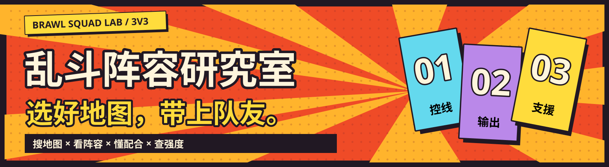
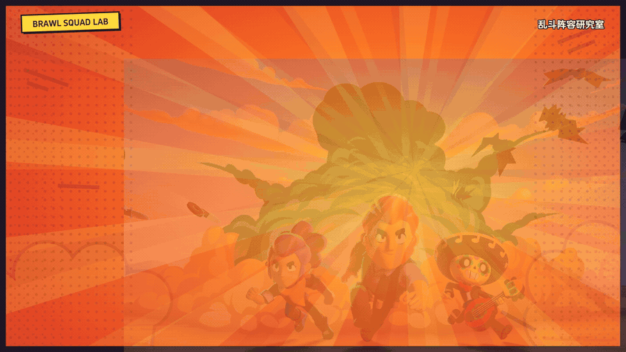
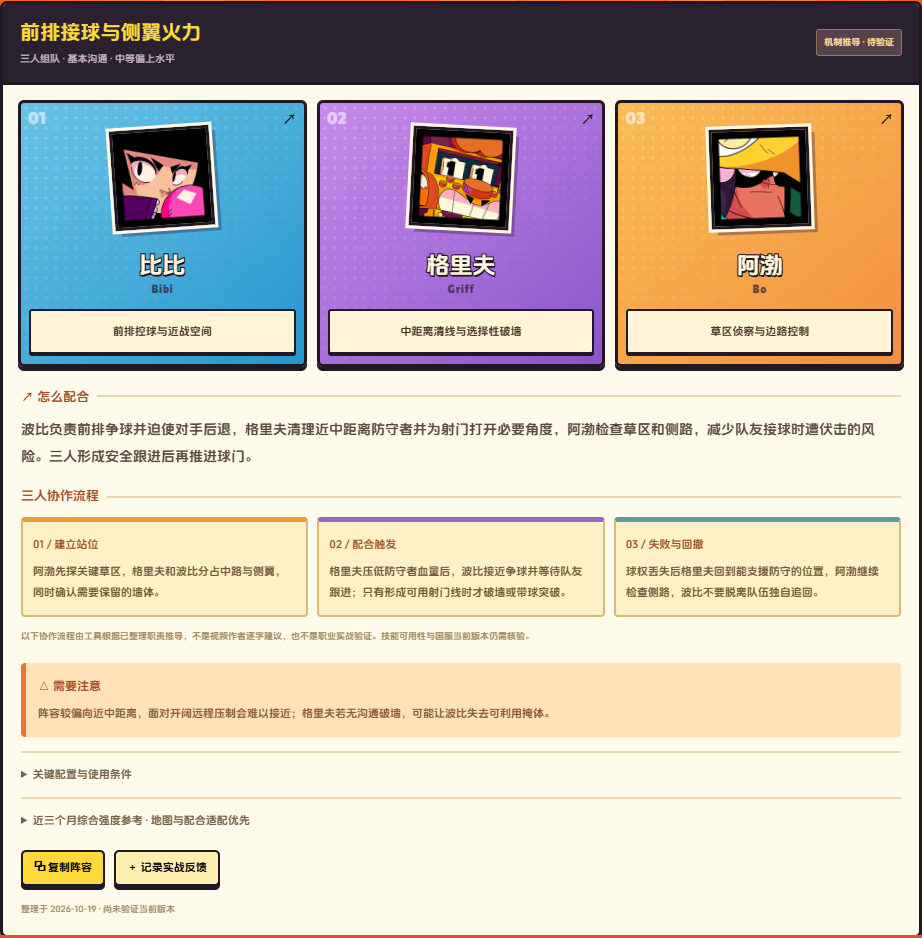
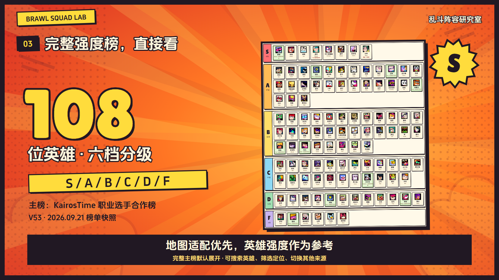

**这张地图，三个人怎么选？**

给和朋友组队的荒野乱斗玩家：搜到地图，看懂分工，再带着配合思路上场。

 

**中文 / English 地图搜索 · 三人阵容与协作 · 完整英雄分级榜 · 职业选角案例**

## 30 秒，看看怎么用

**点击动图观看完整有声视频。** 宣传片为 1080p / 60 fps，25 秒功能介绍 + 5 秒免责声明，配有卡点音乐和中文字幕，无配音。上方是无声节选动图。

[▶ 打开完整视频播放器](https://another1332.github.io/brawlstars-helper/showcase/watch.html) · [仓库内的 MP4 文件](showcase/promo.mp4) · [下载 MP4](https://raw.githubusercontent.com/aNother1332/brawlstars-helper/main/showcase/promo.mp4)

## 你的主场，你来选

**输入中文地图名、英文名或简称，先看地形，再找阵容。** 每张地图保留玩法、模式、地形特点和资料状态；有研究方案的地图会展示完整三人组合。没有整理阵容的地图会明确显示资料范围，不临时补出一套“必胜答案”。

进入网页后，只需三步：

1. **搜地图**：例如“中心舞台”，确认地图与模式。
2. **看三人组**：查看英雄职责、搭配思路、风险和可选方案。
3. **和队友约定配合**：谁占线、谁跟进、何时推进、失误后如何回撤。

[试试中心舞台 ↗](https://another1332.github.io/brawlstars-helper/?map=15000132) · [看看硬石矿井 ↗](https://another1332.github.io/brawlstars-helper/?map=15000007) · [研究甲虫决斗 ↗](https://another1332.github.io/brawlstars-helper/?map=15000306)

## 三个人，一套配合

**三个强势英雄，更要一套漂亮配合。** 阵容说明包含建立站位、配合触发、失败与回撤；以地图适配和角色互补为先，综合英雄强度只作辅助参考。

以图中的中心舞台方案为例：阿渤检查草区和侧路，格里夫清线并选择破墙时机，比比争球与接应，形成安全跟进后再推进。这是机制推导示例，需要结合对手、操作和当前版本判断。

职业研究部分收录 **LCQ 的已核验三人选角案例**，保留对手、选手对应、回放和适用条件。学习职业队的分工与选择逻辑，不把一次选角当作所有对局的标准答案。

## 完整强度榜，打开就能看

默认直接展示完整主榜，支持英雄中英文搜索与定位筛选。其他榜单、Top 10 与来源对照放在二级菜单。

图中主榜为 **KairosTime Gaming 职业选手合作榜，V53，2026-09-21**，完整收录 108 位英雄。水边的皮卡是该榜单的中文解说者，页面分别提供原片与中文解说链接；同源资料不会重复参与推荐加权。榜单是注明日期的版本快照，不代表实时排名。

[直接查看英雄强度榜 ↗](https://another1332.github.io/brawlstars-helper/#rankings)

## 研究室里有什么？

| 内容 | 当前公开范围 |
| --- | --- |
| 地图资料 | 466 条支持模式的地图记录，包含历史与不同 ID 的变体 |
| 三人阵容 | 29 张 3v3 地图、49 套方案，均含职责与协作说明 |
| 英雄资料 | 109 位英雄的中英文基础信息 |
| 默认主榜 | 108 位英雄、S / A / B / C / D / F 六档；原榜未收录英雄单列 |
| 职业案例 | 7 个 LCQ 地图对局，8 套保留对手条件的职业三人模板 |
| 使用方式 | 浏览器直接打开，无需注册；收藏与反馈保存在自己的浏览器 |

以上为 **2026-10-20** 的内容快照。466 条地图记录不等于 466 张当前排位地图，也不表示全部已有阵容推荐。

## 资料有出处，推荐有边界

网页在相关位置保留来源、日期、样本范围、争议及待验证状态。地图和英雄基础信息参考公开游戏资料；地图教学、英雄分级与职业案例来自已读取的公开资料及比赛画面。没有完整读取的字幕或画面不会被描述为已学习的完整观点。

**阵容和配合说明包含 AI 分析，尚未完成当前国服版本与三人实战验证，不保证合理性或胜率。** 适合用作和朋友讨论选角、分工与打法的起点。

## 关于这个仓库

这是 **乱斗阵容研究室的静态发布仓库**，包含网页、公开数据、宣传素材和完整宣传片。网站为纯静态应用，访问者的收藏与反馈保存在自己的浏览器。

网页在 [GitHub Pages](https://another1332.github.io/brawlstars-helper/) 提供服务。开发与资料整理在独立本地源项目进行，由其 `npm run deploy:pages` 同步发布；本仓库不包含本地原始字幕、未公开研究材料或凭据。

非官方、非盈利玩家项目，与 Supercell 无隶属关系。游戏角色、画面及相关标识版权归 Supercell 及相关权利人所有；字体许可见 [assets/fonts](assets/fonts/)。宣传片按制作约定署名 **GPT6.1Sol**，音乐及音效为本地程序原创合成。

**选好地图，带上队友。**

[现在打开乱斗阵容研究室 ↗](https://another1332.github.io/brawlstars-helper/)

